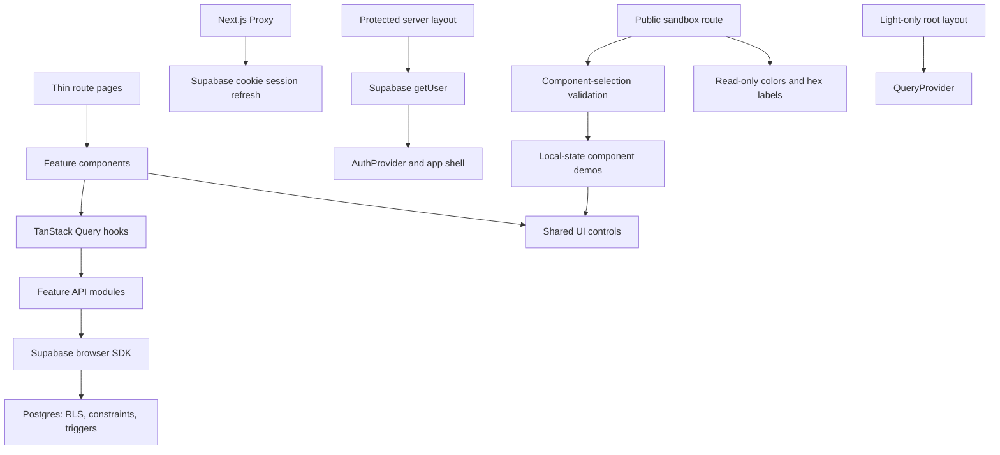

# Project Overview

Selaras is a planned web application for primary-school teachers teaching two classes in one
room. PRD.md defines the MVP: configure the class pair and students, assign observed levels,
form and manually adjust groups within each class, produce a schedule without overlapping
teacher guidance, export independent tasks as PDF/board instructions, and track level history
and progress (`FR-01`–`FR-06`). Students benefit from the outputs but do not use accounts.
Literacy and numeracy are in scope; AI task variations are optional and never allocate teachers.
The six modules remain MVP scope; proposed P0/P1 ordering does not authorize postponing progress
or removing the optional assessment tool (`Q-07`).

**Implemented foundation:** The repository still runs the Fullstack Starter, using Next.js App
Router, strict TypeScript, React, Supabase SSR authentication, TanStack Query, React Hook Form,
Zod, Tailwind CSS, Lucide, and Beautiful UI with unstyled Base UI controls. It has email/password
authentication, confirmation retry, a protected example dashboard, private per-user project
CRUD, and a public sandbox with 81 demos. UI-22 authorizes a Selaras landing page at `/`,
with a CTA to `/kelas` and a footer link to `/sandbox`.
These examples remain available under `ST-01`–`ST-06`; projects are not Selaras sessions.

**UI-only preview:** `/kelas`, `/jadwal`, `/sesi`, and `/progres` use existing UI controls, class-oriented
navigation, fictional students, and local React state (`UI-01`/`UI-02`). The latest screenshots
supply example levels/rubrics and literacy session content; production contracts remain open.
There are no backend calls or product schemas.

**Planned, not implemented:** account-backed Selaras records, persisted level history,
reviewed curriculum content, and persisted progress. Local grouping, phase-aware scheduling,
V1–V5 checks, and browser-based A4 output now exist under UI-18; they do not establish a
production persistence contract. No Selaras schema or feature
tickets exist yet. Proposed routes, tables, level names, API contracts, and owners in PRD.md are
not accepted implementation contracts. Resolve affected `Q-*` questions before Ready tickets.
Login/demo access and persistence are still open; preserve the existing private-access boundary.
Attachment storage, backend search/filtering, and realtime are outside the supplied MVP.
The user explicitly authorized local name search, group filters, and five-row pagination on
the preview's Siswa class cards (`UI-04`); other application filtering remains outside scope.

## Repository Structure

- `.github/`: GitHub Actions validation and issue/pull-request templates.
- `docs/`: Team workflow/prompts and design references under `docs/design/`.
- `PRD.md`: Product requirements, MVP scope, ownership, and open decisions.
- `DESIGN.md`: Selaras design specification using the shared UI. The user's UI alignment request
  applies the supplied Classroomscreen-inspired visual foundation to existing starter screens; product screen decisions stay open.
- `BACKLOG.md`: Canonical tickets, dependencies, acceptance criteria, and implementation prompts.
- `scripts/`: The live two-user Supabase isolation check, `check-rls.mjs`.
- `src/`: Application routes, feature modules, reusable UI, providers, utilities, and types.
- `src/app/`: Thin App Router pages, auth callback, layouts, error states, and app CSS.
- `src/app/(auth)/`: Public login and registration routes.
- `src/app/(dashboard)/`: Protected dashboard, project list, and project-detail routes.
- `src/app/sandbox/`: Only `page.tsx`; sandbox behavior belongs in its feature.
- `src/app/kelas/`: Public UI-only preview routes and layout; product URLs contain no `/app` prefix.
- `src/app/sesi/` and `src/app/progres/`: Short redirects to the example session builder and progress tab.
- `src/features/`: Auth, projects, sandbox, and the local Selaras UI preview, organized into
  purpose-specific category subfolders. The Selaras preview has no feature API/backend modules.
- `src/features/kelas/`: Class list/details, students, levels, grouping, and class fixtures.
- `src/features/landing/`: Public Selaras introduction and preview entry; no backend or identity.
- `src/features/progres/`: Student progress page.
- `src/features/jadwal/`: Overall schedule across classes, served directly at `/jadwal`.
- `src/features/sesi/`: Session list, builder, saved session, schedule, and task fixtures.
- `src/features/shared/`: Preview state, shell, and types shared between page features.
- `src/components/ui/`: One flat reusable component library, CSS tokens, catalog, and MIT notice.
- `src/components/layout/`: The authenticated application shell.
- `src/providers/`: Query cache, authenticated-user lifecycle, and light-only rendering (theme provider removed).
- `src/lib/`: Shared Supabase/Axios clients and color, upload, calendar, table, and chart helpers.
- `src/types/`: Bootstrapped Supabase database types.
- `src/proxy.ts`: Cookie-based Supabase session refresh for matched application routes.
- `supabase/`: Local service configuration, timestamped SQL migrations, and seed file.
- `tests/`: Node contract, utility, color, catalog, and component-rendering tests.
- Root configuration: `package.json`, `pnpm-lock.yaml`, `.nvmrc`, TypeScript, ESLint, and Next.js.
- `.env.example`: Public Supabase configuration and optional disposable test-account variables.

## Build & Development Commands

Use pnpm 10.13.1 from `packageManager`; never use npm or Yarn. `.nvmrc` selects Node 22;
`package.json` requires Node `>=22.18 <25`. Keep dependency versions pinned.

Initial setup:

```sh
nvm use
pnpm install
pnpm run dev
```

Reproducible installs with the existing lockfile:

```sh
pnpm install --frozen-lockfile
```

The landing page and `http://localhost:3000/sandbox` need no Supabase configuration.
For authentication and projects, copy the example and fill in the public development credentials:

```sh
cp .env.example .env.local
```

Required checks:

```sh
pnpm run typecheck
pnpm run lint
pnpm test
pnpm run build
```

Run the production build locally:

```sh
pnpm start
```

Debug server-side development code with the installed Next.js inspector option:

```sh
pnpm exec next dev --inspect 127.0.0.1:9229
```

Keep the inspector local. If the environment blocks Turbopack, the previously verified webpack
build command is:

```sh
pnpm run build --webpack
```

Database commands require Supabase CLI; local services also require Docker.
Confirm the target environment before migrations, resets, or live isolation tests.

```sh
# Disposable local database
supabase start
supabase db reset

# Generate local database types
pnpm run db:types

# Generate types from an already linked development project
supabase gen types typescript --linked > src/types/database.ts

# Two different disposable, confirmed users configured in .env.local
pnpm run test:rls
```

The setup guide describes importing the repository into Vercel, choosing Node 22, configuring public
Supabase variables and Auth URLs, and applying reviewed migrations to the intended database.

> TODO: Define the deployment owner, automated deploy command, and preview/production workflow.
> No deploy script or deployment workflow is configured.

## Code Style & Conventions

- Use strict TypeScript, ES modules, and React function components.
- Match nearby formatting: two-space indentation, double quotes, and semicolons.
- ESLint extends Next.js `core-web-vitals` and `typescript` through `eslint.config.mjs`.
- No repository formatter configuration is present; avoid unrelated formatting changes.
- Use kebab-case filenames, PascalCase components/types, and camelCase functions/variables.
- Use `@/` for application imports from `src/`; preserve explicit `.ts` imports in Node tests.
- Group every feature file under `components/`, `hooks/`, `api/`, `validations/`,
  `constants/`, or `types/`, creating only the folders needed.
- Keep feature roots free of loose files; import modules directly without compatibility re-exports.
- Keep route pages thin. Sandbox catalogs and validation stay under `src/features/sandbox/`.
- Keep Selaras routes directly under `src/app/<path>` without a route-group folder. Keep page
  components and owned fixtures/validations under `src/features/kelas`, `progres`, or `sesi`;
  put only cross-page preview infrastructure in `src/features/shared`.
- Reuse helpers and controls before adding implementations or dependencies.
- Use React Hook Form for forms and Zod at both form and feature API boundaries.
- Document deliberate limitations as `shortcut: <limit>, <when to upgrade>`.

UI conventions:

- UI-20/DES-34 seeds independent classes 1–6, each with 32 fictional students, and a floating
  combine flow for any neighboring grades: 1+2, 2+3, 3+4, 4+5, 5+6, in either order.
  Preserve the legacy 2+3 demo. Merge rosters without changing student IDs/history;
  standalone details render only their first class and cannot schedule until paired. Combined
  cards retain both banners/identities around a plus. The floating action alone uses 64 px circle.
  Cards follow main's banner/title/separated metadata-footer layout; keep AvatarGroup and count
  in the footer instead of a user icon, alongside the last-session date or Belum ada sesi.
  Match main's 1/2/3-column grid (sm/xl), 20 px gaps and 16 px card-body/footer spacing; these
  card-specific measurements override the general 15/30/60 px spacing convention.
  Combined wrappers span two columns at sm with a two-column internal grid and the same 20 px
  gap; center the plus absolutely so constituent cards retain independent-card widths.
  List Kelas gabungan above Kelas mandiri in separate titled sections with independent empty
  states; shared search covers both. Combine selection continues to show only independent classes.
- UI-21/DES-35 permits optional memory-only task photos (JPG/PNG/WebP, 5 MB), with decoding,
  cancel cleanup and shared upload UI. No storage service. Keep photos in saved task snapshots;
  V5 requires teacher declaration for low-level non-reading suitability. Do not claim OCR checks.

- UI-19/DES-33 permits local draft/saved-session editing and a mapel Select with custom Lainnya.
  Save edited snapshots, preserving saved roster and session ID. Revalidate content and V1–V5;
  allow mixed 10/15/20-minute core blocks and multiple tasks per student, with full coverage.
  Confirm regeneration before replacing manual edits. Keep 1–2 non-reading and student output safe.

- UI-18/DES-32 adds pure local phase-aware scheduling and independent V1–V5 checks. Save/print
  validated snapshots only. Draft exercises serve literacy/numeracy 1–5; teachers provide level-six
  tasks. Board/A4 sheets use a separate projection without roster identifiers, names, levels or
  phase labels. No AI/backend/persistence. Longer group sheets may continue without clipping.

- UI-17/DES-31 separates session lessonSubject/topic from literacy/numeracy focus. Accept
  teacher-entered subject names; grouping and saved roster snapshots use focus. Use the existing
  phase-aware structure from UI-18 for all subjects with neutral teaching prompts; do not
  substitute literacy material or claim curriculum content/other-subject assessments are available.
  Carry mapel/topic/focus through session lists, detail, Jadwal, board and print. No backend.

- Siswa tables, group filters/cards, and member-level labels share the selected subject (`UI-15`, `DES-29`). Save session rosters with that session’s subject grouping; preserve saved snapshots. Missing levels keep their current group and show Belum dinilai in the preview. Keep the Panduan kelompok dialog beside the subject selector (`UI-15-AC-06`).
- UI-23 keeps Siswa tables at five 52 px rows and group-member tables at five 64 px slots, filling
  unused space with same-height blank rows (plus one empty message row for empty lists). Group cards paginate five
  actual members per page, independently by class/group/subject. Always show shared Pagination, disabled at five or fewer, reduce
  member-row padding, hide its decorative level Badge dot, and do not fix card height.

- Use the six accepted literacy/numeracy levels and criteria in `UI-14`/`DES-28`, while keeping three groups A/B/C per class. Level changes append history; UI-15 maps unadjusted students to Biru 1–2 / Hijau 3–5 / Oranye 6 per subject, preserving manual moves for that subject.
- Independent-task guidance uses each student’s focus level: 1–2 non-reading only, 3–5 matching practice, 6 class-phase content. Mixed groups need differentiated guidance; no invented phase objectives. UI-17 permits a neutral timing structure for numeracy and other subjects, with teacher-prepared lesson content.

- Product spacing uses 15 px small, 30 px medium, and 60 px between content groups (`UI-11`, `DES-25`); preserve icon micro-gaps and control heights.
- Level uses direct Observasi entry; history-first dialogs elsewhere remain. Overall Jadwal combines complete saved schedules by date, using saved rosters/grades without inventing start times.

- Keep reusable controls together in `src/components/ui/`; do not create a separate library folder.
- Keep Beautiful UI components, Base UI behavior, and Lucide icons; apply the user-supplied Classroomscreen styling without adding shadcn.
- Apply accepted product layouts and styling from DESIGN.md through the existing UI and token files.
  An intentional change to a documented visual convention must be explicit and aligned here first.
- The user explicitly accepted Nunito, indigo actions, pastel surfaces, and larger pill
  buttons for existing UI. The latest user update makes the app light-only, primary #7173FF,
  controls with 10 px corners, and a white sandbox preview with a read-only five-color palette. These replace the earlier Inter/neutral/compact-button rules.
  Apply DES-02–DES-05 while leaving unresolved product screens and contracts untouched.
- Use Nunito with system font fallbacks (`UI-10`, `DES-24`); minimum visible text is 12 px.
  Tokens and catalog CSS live in `src/components/ui/globals.css`;
  app aliases and matching styles live in `src/app/globals.css`.
- Use the shared Button: 10 px corners, #7173FF default primary, 8 px gap,
  default size sm (40 px), optional xs (32 px) for every variant, and 0.98 press scale.
  Primary #7173FF and destructive #FF3C7F fills use white, bold 19 px text; legacy md/lg size props fall back to sm.
- Button and IconButton support `xs/sm` at 32/40 px high (icon buttons 32/40 px square). Preserve disabled and loading behavior.
- Shared Select triggers and option rows use 32 px minimum height, 14 px text, and compact
  padding. Keep Base UI keyboard/focus behavior and use shared sizing in feature tables.
- Keep `primary/secondary/ghost/danger/quiet` variants and the semantic destructive Button.
- Apply the five-color palette across all existing UI: #7173FF primary/selection, #FF3C7F
  destructive/error, #95F447 success, #00E5E3 information, and #F2F226 warning/pending. Use
  palette-derived tints and dark text shades; preserve white/neutral surfaces and intrinsic asset colors.
  Use white on purple/pink fills and dark ink on lime/cyan/yellow. Do not add
  arbitrary per-button colors or accent/success Button variants. Icon buttons use 10 px corners and accessible labels.
- For button-like navigation, use Button with `nativeButton={false}`, `role="link"`, and
  `render={<Link href="…" />}`; do not nest buttons and anchors.
- Keep inline text links, navigation rows, and linked cards in their own link presentation.
- The product uses a header with logo, centered Kelas/Jadwal links, moving purple active
  underline, and profile menu. SidebarNav remains available to the sandbox and starter.
- RootLayout keeps the public preview provider and shell mounted across product navigation;
  the shell renders its header only on `/kelas` and `/jadwal`, preserving other starter pages.
- Product cards, fields, and table surfaces use consistent 2 px outlines. Selects and menus
  use pastel fills with dark matching text; retain semantic danger and keyboard/focus behavior.
- Level tables omit the redundant Kelas column and paginate ten rows per class. Observation
  history opens before adding a note. Product copy avoids “contoh”, phase labels, and jargon;
  keep a concise, truthful notice that local changes disappear on reload.
- Selaras app cards and table surfaces use borders with no resting or hover shadows. Its
  header profile uses shared Avatar/DropdownMenu with a labeled demo profile and only the
  disabled Settings/Sign out options; do not connect its demo identity to starter auth (`Q-03`).
- Toasts use neutral surfaces, status icons, and subtle type tints without colored borders.
- Preserve accessible labels, errors, focus, keyboard navigation, and reduced-motion behavior.
  Filled action labels must retain large-bold-text/hover contrast; destructive states stay semantic.

> TODO: Define a commit-message template and whether Conventional Commits are required.
> No commit-message enforcement is configured.

## Architecture Notes



Ordinary application data follows component → TanStack Query hook → feature API module →
shared Supabase SDK. Authentication forms use the auth API directly; the auth provider owns
session lifecycle subscriptions. No CRUD Route Handlers, Server Actions, or separate backend
are needed.

The protected layout verifies the user with `getUser`. Proxy refreshes cookie sessions and
calls `getClaims`. Database RLS is the ownership boundary; redirects and UI visibility
do not authorize access.

Project ownership defaults to `auth.uid()`. Constraints validate fields, and a trigger maintains
timestamps and prevents changes to ownership, ID, and creation time. Update/delete APIs reject
zero affected rows; unknown and inaccessible projects share an unavailable state.

Query keys are `['projects', userId]` and `['project', userId, projectId]`. Create invalidates
lists; update invalidates lists/detail; delete removes detail and invalidates lists. Account
changes and logout clear private cached data. Queries use a 30-second stale time and one default
retry; mutations do not automatically retry.

The sandbox is public and uses sample state rather than private records or fake authentication.
Its SidebarNav shows one alphabetical, searchable catalog. Only the selected demo mounts.
Invalid or repeated component query parameters default to Buttons. The dialog reuses ProjectForm
with a sample submit callback.

The UI is light-only by explicit user request. RootLayout ignores old theme cookies; theme
provider, toggle, demo, and dark CSS were removed. Only the Colors demo shows #7173FF,
#FF3C7F, #95F447, #00E5E3, and #F2F226 with hex labels below. There is no picker, preview state,
root style override, or new persistence. Reset only resets demo state and component selection.

External-service extensions use the shared Axios client → authenticated Route Handler →
server-only implementation. The client has a 15-second timeout; no external-service endpoint
is currently implemented.

For planned Selaras work, preserve that data path and cookie-based SSR auth; the UI is light-only. Deterministic
phase detection, grouping, scheduling, and level comparison must be explainable and testable
without AI. Groups stay within their class, each student belongs to one group per session, and
teacher guidance cannot overlap (`FR-03`–`FR-04`). Activity templates must work without an AI API
(`FR-05`). The domain signatures and generation/export endpoints in PRD.md are proposals, not
existing modules or a requirement to introduce Route Handlers for ordinary CRUD.

If account-backed Selaras storage is selected, all private descendants must follow the verified
teacher owner (`FR-07`), including cross-entity references. Use user-scoped cache keys and preserve
account-change/logout clearing. Project RLS does not protect new tables. Do not rename projects
into sessions or reuse their statuses as a product contract; schema, cache invalidation, session
snapshots, and route protection must be specified in the relevant ticket after `Q-03`/`Q-09`/`Q-11`.
New protected routes must account for both the server layout and the proxy matcher; proposed
`/sessions` and `/progress` routes are not currently matched by `src/proxy.ts`.

## Testing Strategy

1. Run `pnpm run typecheck`, `pnpm run lint`, `pnpm test`, and `pnpm run build`.
2. Add a small meaningful test for new nontrivial logic; trivial and documentation edits need none.
3. For ownership/schema changes, run `pnpm run test:rls` against a confirmed disposable environment.
4. For UI changes, check light-only rendering, palette labels and filled-button contrast, keyboard behavior,
   focus return, reduced motion, and 360 px.
5. Report actual results and skipped checks; do not treat historical verification as current proof.

`pnpm test` uses Node's built-in test runner, assertions, and experimental TypeScript stripping.
The suite covers schema validation, safe return URLs, user-scoped cache keys, palette display and color contrast,
chart/calendar/table/upload helpers, catalog completeness, and control semantics.
Rendering tests transpile real JSX in memory with TypeScript and use React server rendering;
they do not prove browser interactions.

The live RLS script uses two Supabase users, checks isolation and constraints, and attempts
cleanup. Configure the six variables listed in `.env.example`. Never run it against production.
It currently checks `projects` only. New Selaras ownership/schema work must add meaningful
coverage for its entities and cross-owner references; an unchanged project isolation check
cannot prove `FR-07` for student/session data.

Future product tests must trace to PRD acceptance IDs: phase pairs 2 + 3 and 3 + 4, same-class
membership/manual moves, nonoverlapping guidance and lowest-level priority, template fallback,
downloaded PDF opening offline, and preserved assessment history with up/same/down comparison.
Decide level, duration, and content contracts before fixing expected values. Test invalid input,
failed/duplicate submissions, unavailable records, and account cache isolation (`FR-07`–`FR-08`).
The 15 fictional students and sub-90-second flow are demo criteria, not a product capacity limit
or evidence of learning impact. Starter tests do not prove these planned features.

GitHub Actions runs on pushes to `main` and pull requests. It uses Node from `.nvmrc`,
pnpm setup, lockfile-aware installation, typecheck, lint, tests, and the default production build.
It does not run live RLS or browser tests.

> TODO: Choose an e2e runner and configure disposable infrastructure for browser/integration CI.
> No Playwright, Cypress, or automated browser suite is configured.

## Security & Compliance

- Keep passwords, tokens, service-role keys, and other secrets out of source, logs, and commits.
- Store local credentials in ignored `.env.local`; keep `.env.example` free of real values.
- `NEXT_PUBLIC_SUPABASE_URL` and `NEXT_PUBLIC_SUPABASE_PUBLISHABLE_KEY` are public browser config.
  Never place privileged credentials in `NEXT_PUBLIC_*` variables.
- Mark secret or privileged modules `server-only`; shared validations/types must not import them.
- Verify sensitive server operations independently with `getUser` or `getClaims`.
- Do not authorize from `getSession`, client-supplied ownership, redirects, or hidden controls.
- Preserve RLS, constraints, owner-derived inserts, and zero-row mutation checks.
- Retain input on failed submissions and prevent duplicate mutations or false success feedback.
- Restrict auth return destinations with the existing `safeReturnPath` validator.
- Preserve PKCE/token-hash confirmation, cookie refresh, and safe unavailable/error states.
- Upload controls provide selection and presentation only; trusted storage boundaries must
  independently validate files before accepting them.
- Keep student identities, assessments, sessions, and derived outputs in the owning teacher's
  private area if account storage is selected (`FR-07`). Do not create public student links,
  cross-teacher sharing, or student/parent/admin roles from an unresolved permission model.
- Use clearly labeled fictional students for demos; keep sandbox sample state separate from
  private records. Printed group names are neutral and must not expose ability labels (`FR-03`).
- Downloaded PDFs may be opened offline; this does not authorize public export URLs or promise
  offline app operation. Real-student data, retention, deletion, and export storage await `Q-09`.
- Nunito uses the SIL Open Font License; preserve its license with the bundled font.

Review dependency advisories with:

```sh
pnpm audit
```

Do not run `pnpm audit --fix` automatically or upgrade unrelated packages.

> TODO: Define dependency/secret-scanning CI, vulnerability triage, and applicable privacy rules.
> No automated scanning workflow or documented compliance program is present.

Beautiful UI source retains the MIT notice, copyright © 2026 Shane Levine, in
`src/components/ui/LICENSE`. Preserve the notice in copies and substantial adaptations.

> TODO: Choose the repository-wide license; no root license file is present.

## Agent Guardrails

- Follow the current user request and higher-priority instructions.
- For product work, read PRD.md, DESIGN.md, BACKLOG.md, and the assigned ticket before editing.
  PRD owns behavior, accepted DESIGN decisions own presentation, this file owns implementation
  conventions, and BACKLOG owns task scope/prompts. Identify conflicts instead of silently
  selecting a rule. Preserve stable PRD requirement/acceptance IDs in tickets and validation.
- The user authorized the UI-only Selaras preview (`UI-01`). The latest four screenshots (`UI-02`, `DES-18`) supersede the guided-flow placeholders with
  class tabs and nested session routes. Use their supplied fixture content and breadcrumb hierarchy;
  derive counts from the level screenshot's 7+8 roster; `UI-10` supersedes the earlier sidebar with the product header.
  Memory-only saves and browser print must be identified accurately. This does not settle
  production auth/routes, pedagogical content, scheduling, persistence, or PDF contracts.
- Templates/TODOs are not product decisions. Do not implement an unresolved requirement or
  invent missing behavior to mark a ticket Ready; continue independent authorized work.
- PRD labels `[USULAN]`/`[ASUMSI]` and its `Q-*` table identify unresolved choices. Proposed
  schemas, routes, endpoints, and Dev 1–4 assignments are not approved. Six subject-level names/criteria are accepted in UI-14.
  BACKLOG.md has no product tickets; the PRD's `B*` planning table is not a Ready backlog.
- Keep complete, specific implementation prompts inside each Ready BACKLOG.md ticket.
  Use one owner, branch, and PR per ticket; do not merge or expand scope without authorization.
- Coordinate shared-file changes and use separate checkouts/worktrees for concurrent agents.
  Product/design changes update the source document and affected prompts before implementation.
- Read this file and any applicable nested `AGENTS.md` before editing; deeper instructions
  specialize their directory's conventions within those higher-priority instructions.
- Inspect callers, tests, configuration, and affected contracts; use `rg` for searches.
- Make the smallest complete change and preserve unrelated user edits.
- Use pnpm and the existing lockfile; never create npm/Yarn lockfiles or silently change tooling.
- Do not hand-edit generated `next-env.d.ts`, database types, build output, or dependency contents.
  Regenerate `src/types/database.ts` through the documented command after schema changes.
- Do not edit SQL migrations already applied to shared environments; add timestamped migrations.
- Never overwrite real environment files, expose secrets, or remove license attribution.
- Confirm database targets before writes; use disposable data and clean up test records.
- Keep auth/dashboard/projects unless their removal is explicitly requested (`ST-01`–`ST-03`).
  Product adaptation and the entry screen are unresolved (`Q-03`, `Q-08`); do not convert example
  records or dashboard statistics into student sessions or progress.
- UI-22/DES-36 replaces the centered landing buttons with the public Selaras introduction at
  `/`, linking to `/kelas` and retaining `/sandbox` in its footer. Scope its marketing header
  to that page; preserve other starter routes, auth and product navigation. Describe preview
  features truthfully, including fictional data and memory-only changes; no invented impact claims.
- Keep all remaining sandbox demos public and available. The read-only palette belongs only in
  the Colors demo; the sidebar palette, Theme Toggle, and accent picker were removed by request. Do not add radius controls,
  customization pages, workspace previews, instructional design panels, or private connections.
- Preserve upload queue capacity checks and object-URL cleanup; DataTable processes supplied
  rows locally while application filters belong in the feature data layer.
- Keep Selaras scope teacher-only: no attendance, parent messaging, school integrations,
  automatic cross-class grouping, new assessment scales/content banks for other subjects, full offline PWA, or extra analytics. UI-17 allows teacher-entered subject context in local session plans. A
  Classroomscreen reference does not authorize a draggable widget canvas or customization UI.
- Preserve level history on reassessment and never present progress as causal learning impact.
  Do not infer unapproved draft recovery, regeneration, deletion, or baseline rules.
- Complete the required checks for runtime/dependency changes and state any restrictions.
- Do not deploy, publish, or modify production infrastructure without task authorization.

The PR template requests validation evidence, ownership checks where relevant, configuration
changes, and known limitations.

Product decisions still required (PRD.md section 17 owns the full questions and affected criteria):

| TODO / PRD question IDs        | Boundary to preserve until decided                                                                                                                                                                                             |
| ------------------------------ | ------------------------------------------------------------------------------------------------------------------------------------------------------------------------------------------------------------------------------ |
| `Q-01`, `Q-04`, `Q-12`         | Session/block duration, tie-breaking, class/group edge cases, capacity, and final grade-input limits are not fixed contracts (`FR-01`–`FR-04`).                                                                                |
| `Q-02`, `Q-10`, `Q-13`         | Six level names/order/criteria per subject are accepted (UI-14); assessment scoring, baseline/correction rules, session subject selection, and curriculum/template review remain open (`FR-02`–`FR-06`).                                                                  |
| `Q-03`, `Q-08`, `Q-09`, `Q-11` | Login/demo identity, product entry/routes, example adaptation, persistence/retention/deletion, and draft/regeneration semantics remain open (`FR-07`–`FR-08`, `ST-01`–`ST-04`).                                                |
| `Q-05`, `Q-06`, `Q-14`         | PDF/board layout, fictional-demo permission, and device/network/performance acceptance need decisions (`FR-05`, `NFR-01`–`NFR-03`, `NFR-08`).                                                                                  |
| `Q-07`                         | P0/P1 planning is proposed; the six MVP modules remain in scope until a cut is explicitly accepted.                                                                                                                            |
| `Q-15`                         | The latest Nunito/#7173FF/pastel/10 px corners/light-only/read-only palette foundation is accepted for existing UI. Product-screen compositions still need acceptance; no classroom canvas or new product scope is authorized. |

TODO: Resolve these choices in their source documents, realign this file, then update affected
BACKLOG prompts. Block only affected work; do not invent values to unblock it. The PRD records
the earlier shadcn recommendation as an unaccepted conflict; the shared UI remains mandatory.

> TODO: Define reviewer ownership and approval requirements for auth, schema, and deployment changes.
> No CODEOWNERS file or branch-protection policy is available in the repository.

> TODO: Specify quotas and rate limits before implementing AI or other paid external services.
> No application rate limiter or quota implementation currently exists.

## Extensibility Hooks

- Add features under `src/features/<feature>/` using the category folders and existing data path.
  Future Selaras tickets must identify new folders/files explicitly; do not scaffold proposed
  session/student modules or contracts merely because they appear in the PRD.
- Add reusable controls under `src/components/ui/` and provide a working sandbox demo.
- Sandbox catalog data lives under `src/features/sandbox/constants/`; selection validation
  lives under `validations/` and demos under `components/`.
- Imported catalog entries and demos live in `src/components/ui/meta.ts` and `registry.tsx`.
- Adapt shared colors, radii, and typography through the existing CSS token files.
- Use `src/lib/axios.ts` for future external Route Handler integrations.
- Add database schema changes through migrations and regenerate database row types.
- AI is optional task variation with template fallback, never a scheduler (`ST-07`). A concrete
  integration ticket must settle provider, data sent, and quota/rate-limit rules before use.
  Attachment storage, application search/filtering, and realtime require separate explicit scope;
  local Supabase storage is currently disabled. PDF export does not implicitly add file upload.
- Configure `NEXT_PUBLIC_SUPABASE_URL` and `NEXT_PUBLIC_SUPABASE_PUBLISHABLE_KEY` before building
  authenticated deployments.
- Live isolation tests additionally use `RLS_TEST_USER_A_EMAIL`, `RLS_TEST_USER_A_PASSWORD`,
  `RLS_TEST_USER_B_EMAIL`, and `RLS_TEST_USER_B_PASSWORD`.
- No runtime feature-flag framework or plugin loader is implemented.

> TODO: Document additional environment variables and feature flags when an extension needs them.

## Further Reading

- [Product requirements](PRD.md)
- [Product design and starter UI alignment](DESIGN.md)
- [Canonical backlog and ticket format](BACKLOG.md)
- [Team workflow and planning/review prompts](docs/team-workflow.md)
- [Step-by-step product and team workflow](README.md)
- [Setup, Supabase confirmation, and deployment](docs/setup.md)
- [Scripts and dependency versions](package.json)
- [CI checks](.github/workflows/ci.yml)
- [Pull-request template](.github/PULL_REQUEST_TEMPLATE.md)
- [Feature issue template](.github/ISSUE_TEMPLATE/feature.md)
- [Project ownership migration](supabase/migrations/20261011000000_projects.sql)
- [Local Supabase configuration](supabase/config.toml)
- [Database isolation script](scripts/check-rls.mjs)
- [Sandbox selection validation](src/features/sandbox/validations/component.ts)
- [Beautiful UI license](src/components/ui/LICENSE)
- [Design reference index](docs/design/design-list.md)

> TODO: Add ADRs when durable architecture decisions need a separate record.

Documentation creation does not verify live authentication, database isolation, or deployment.
Browser, infrastructure, and dependency-audit checks must be run and reported for the relevant task.
